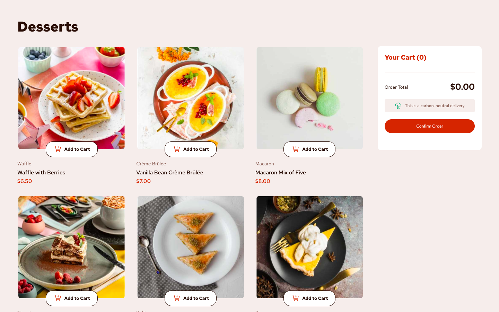

# Frontend Mentor - Product list with cart solution

This is a solution to the [Product list with cart challenge on Frontend Mentor](https://www.frontendmentor.io/challenges/product-list-with-cart-5MmqLVAp_d). Frontend Mentor challenges help you improve your coding skills by building realistic projects. 

## Table of contents

- [Overview](#overview)
  - [The challenge](#the-challenge)
  - [Screenshot](#screenshot)
  - [Links](#links)
- [My process](#my-process)
  - [Built with](#built-with)
  - [Continued development](#continued-development)
  - [AI Collaboration](#ai-collaboration)
- [Author](#author)
- [Acknowledgments](#acknowledgments)

**Note: Delete this note and update the table of contents based on what sections you keep.**

## Overview

### The challenge

Users should be able to:

- Add items to the cart and remove them
- Increase/decrease the number of items in the cart
- See an order confirmation modal when they click "Confirm Order"
- Reset their selections when they click "Start New Order"
- View the optimal layout for the interface depending on their device's screen size
- See hover and focus states for all interactive elements on the page

### Screenshot

### Links

- Solution URL: [Click Here](https://github.com/kartik-kumar25/product-list-with-cart-main.git)
- Live Site URL: [Click Here](https://kartik-kumar25.github.io/product-list-with-cart-main/)

## My process

### Built with

- Semantic HTML5 markup
- CSS custom properties
- Flexbox
- CSS Grid
- Mobile-first workflow

### Continued development

- Device screen size interfernce

### AI Collaboration

- VS code (copilot)
- ChatGPT

## Author

- Frontend Mentor - [@kartik-kumar25](https://www.frontendmentor.io/profile/kartik-kumar25)
- GitHUb - [@kartik-kumar25](https://github.com/kartik-kumar25)
**Note: Delete this note and add/remove/edit lines above based on what links you'd like to share.**

## Acknowledgments

 A huge thank you to Frontend Mentor for the amazing project prompts and designs. Their challenges gave me the perfect opportunity to practice my coding and build this real-world application.
